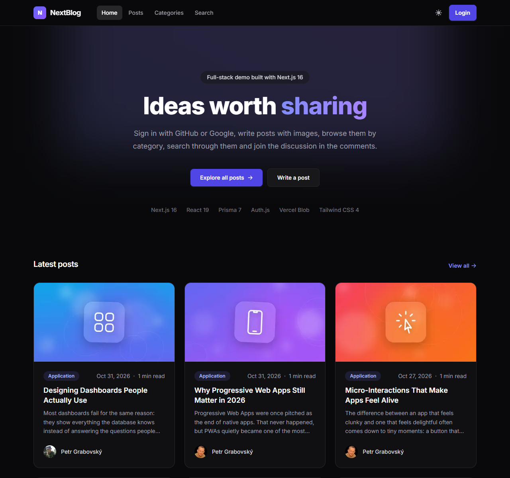

# NextBlog – Full-Stack Next.js Blog

A full-stack blog application built with the Next.js App Router. Users sign in with GitHub or Google, write blog posts with images, browse them by category, search through them and discuss in the comments.

**Live demo:** https://nextjs-fullstack-blog-grabovsky.vercel.app



I started NextBlog in August 2024 as my first full-stack project, while learning to program. In October 2026 I rebuilt it with Claude Code on current versions of Next.js, React, Prisma and Auth.js, moved images from Firebase to Vercel Blob, and moved every authorship check to the server.

## Features

- Sign in with **GitHub** or **Google** (Auth.js v5)
- Create blog posts with an image upload to **Vercel Blob**, with server-side validation (zod)
- Browse all posts and filter them by category
- Search titles and post text, case-insensitive (shareable URL `?q=`)
- Comments with author badge; authors can delete their own posts (with confirmation) and comments
- Light and dark theme, responsive layout with mobile menu

## Tech Stack

| Area      | Technology                                                           |
| --------- | -------------------------------------------------------------------- |
| Framework | Next.js 16 (App Router, Server Components, Server Actions), React 19 |
| Database  | PostgreSQL (Neon) via Prisma 7 with the Neon driver adapter          |
| Auth      | Auth.js (NextAuth v5) – GitHub & Google OAuth, JWT sessions          |
| Storage   | Vercel Blob for post images                                          |
| Styling   | Tailwind CSS 4, next-themes                                          |
| Tooling   | TypeScript, ESLint 9, Prettier, Husky + lint-staged                  |

## Architecture

- **Server Components** read data directly from the database through Prisma (`database/queries.ts`), there is no internal REST API.
- **Server Actions** (`utils/actions.ts`) handle all mutations. Every action verifies the signed-in user and authorship on the server.
- **Cache Components:** post queries use `'use cache'` with tags, and the Server Actions refresh them with `updateTag` after a post or comment changes. The home page, the post list, the categories and existing posts are prerendered at build time, and the parts that depend on the signed-in user load in Suspense.
- Comments are stored in a separate `Comment` table, so concurrent comments never overwrite each other.
- Uploaded images are validated (type and size) and stored in Vercel Blob under random names.
- Database migrations are applied automatically on Vercel by the `vercel-build` script.

## Getting Started

Requirements: Node.js 24 and a PostgreSQL database.

1. Install dependencies (this also generates the Prisma client):

   ```bash
   npm install
   ```

2. Create `.env.local` with these variables (or run `vercel env pull .env.local` for a linked Vercel project):

   ```bash
   POSTGRES_URL=               # pooled connection string used by the app
   POSTGRES_URL_NON_POOLING=   # direct connection string used for migrations
   NEXTAUTH_SECRET=            # random secret, e.g. `npx auth secret`
   GITHUB_CLIENT_ID=
   GITHUB_CLIENT_SECRET=
   GOOGLE_CLIENT_ID=
   GOOGLE_CLIENT_SECRET=
   BLOB_READ_WRITE_TOKEN=      # Vercel Blob store token
   ```

   OAuth callback URLs: `http://localhost:3000/api/auth/callback/github` and `http://localhost:3000/api/auth/callback/google`.

3. Apply database migrations and start the dev server:

   ```bash
   npx prisma migrate deploy
   npm run dev
   ```

4. Open [http://localhost:3000](http://localhost:3000).

## Scripts

| Script              | Description                   |
| ------------------- | ----------------------------- |
| `npm run dev`       | Start the development server  |
| `npm run build`     | Create a production build     |
| `npm run start`     | Run the production build      |
| `npm run lint`      | Run ESLint                    |
| `npm run typecheck` | Run the TypeScript type check |

## Author

Petr Grabovský · [LinkedIn](https://www.linkedin.com/in/petr-grabovsky) · [GitHub](https://github.com/PetrGrabovsky)
